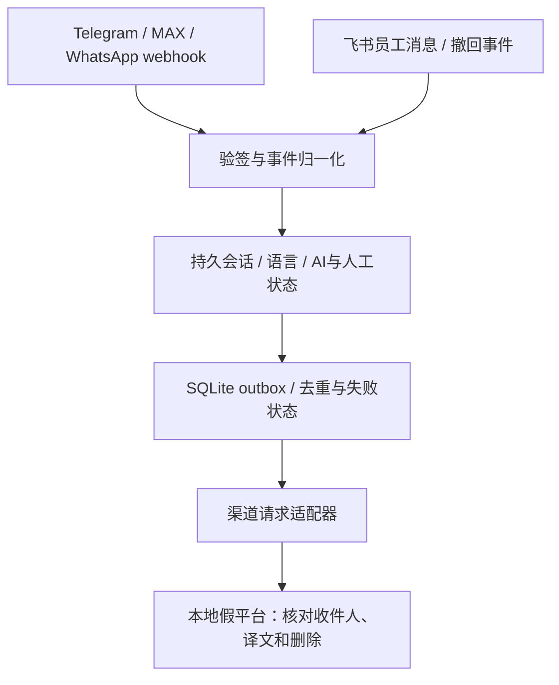

# OmniService

面向跨平台客服的项目，目标是在飞书处理客户消息，并提供翻译、AI 接待和人工交接。

**接入状态：俄罗斯 MAX 和 WhatsApp 的真实平台接入尚未实现和验收，目前只有模拟适配与测试。** Telegram–飞书另有个人账号接入代码，部署和验证范围见[团队部署](docs/personal-deployment.md)。不要把模拟测试结果当作真实平台已接通。

## 当前交付：P0 Linux 模拟闭环

Telegram–飞书团队接入见[团队部署](docs/personal-deployment.md)，包括 Linux 服务、平台授权与客服邀请。

在 Codex 中可用 `$omni-service-onboarding` 复用接入和验收流程。[OmniService 接入 Skill](.agents/skills/omni-service-onboarding/SKILL.md)

本仓库当前交付可运行的协议与会话验收台。HTTP webhook、渠道适配、SQLite 队列、会话状态及出站 HTTP 都执行实际代码；平台接收端和 AI/翻译使用确定性模拟服务。**这不是已接通真实账号的生产部署。**

- 模拟 Telegram / MAX / WhatsApp：一账号多客户、账号和客户隔离、批量回调与去重。
- 飞书：自动/手动建群、加入员工、7 人普通回复默认对客、成员权限及原生撤回事件。
- 语言：根据客户实际消息识别和记忆语言，员工中文自动翻译；当前中、俄、英、西模拟语料用于验证流程。
- AI：已知知识问答自动接待，未知或人工请求建群；员工介入取消未发 AI 并暂停新自动回复，显式恢复后继续；已在途请求按实际回执处理。
- 可靠性：持久 inbox/outbox、重启恢复、429 有限重试、认证失败终止、投递结果未知不盲重发。
- 撤回：发送前取消；Telegram/MAX 发送后删除；WhatsApp 发送后返回不支持；失败或未知单独记录并提示员工。

完整媒体二进制转存、真实模型质量、Chatwoot/NextBridge 联调及真实账号接入已列入[后续范围](docs/acceptance.md#模拟边界与完整产品待办)。媒体解析和请求构造已保留，尚未上传到目的平台的附件标记为 `media_pending`，不会把源平台文件 ID 发到另一平台冒充成功。

## 一条命令验收

环境：Linux、Python 3.12+。运行与测试只用 Python 标准库，无须 pip 安装、数据库服务器、平台 token 或外网访问。

```bash
git clone https://github.com/reknottycat/omni-service.git
cd omni-service
bash scripts/acceptance.sh
```

结果写入 `artifacts/acceptance.json` 和 `artifacts/acceptance.log`。失败返回非零退出码。报告记录每项测试结果、Linux/Python/SQLite 环境、源文件 SHA256 清单和源码总指纹。默认分支为 `codex/public-release`；历史 PR 的合并状态另行记录。

查看三个渠道的完整模拟对话：

```bash
python3 scripts/demo.py
```

演示实际启动两个本地 HTTP 服务，将俄语客户消息送入服务、建立飞书会话、转发员工中文译文，再请求撤回。`artifacts/demo.json` 保存假平台实际收到的 HTTP 请求及对话结果，认证值不写入记录。

## 消息如何流动



服务群普通成员消息默认同步给对应客户，不增加内部/外部两种发送模式。平台服务通知由机器人发给员工，不会回环为新的客户回复。客户在自己的平台仍看到官方账号，员工以署名区分。

## 本地 HTTP 接口

`scripts/demo.py` 自动管理本地假平台和服务。手动调试时可使用 `python3 -m omni_service.server --fake-platform-url http://127.0.0.1:<port> --db state.sqlite3 --port 8080`，并设置 `PYTHONPATH=src`。每次 webhook 只做持久接收，调用 `/api/drain` 处理到期队列，便于模拟限流、重启和撤回竞态。

| 接口 | 用途 |
|---|---|
| `GET /health` | 返回明确的 `simulation` 模式 |
| `POST /webhooks/{channel}/{account_id}` | 带对应平台认证的 webhook |
| `GET /webhooks/whatsapp/{account_id}` | WhatsApp challenge 校验 |
| `GET /api/conversations` | 查看隔离会话 |
| `GET /api/conversations/{id}` | 查看成员、消息、译文、投递与撤回状态 |
| `POST /api/conversations/{id}/handoff` | 转人工并建立飞书会话 |
| `POST /api/conversations/{id}/members` | 加入员工，JSON 字段 `staff_id` |
| `POST /api/conversations/{id}/resume` | 恢复 AI |
| `POST /api/conversations/{id}/messages/{mid}/recall` | 请求撤回，JSON 字段 `actor_id` |
| `POST /api/drain` | 执行当前到期的持久队列 |

`/api/*` 需要 `Authorization: Bearer simulation-admin`。默认模拟账号及 webhook secret 在 `server.DEFAULT_ACCOUNTS`；这些是公开测试值。程序限制监听和出站目的地为本机 loopback，拒绝真实平台 URL 和重定向。不要把此模式直接暴露到公网。

## 状态含义

| API / 数据状态 | 含义 |
|---|---|
| `cancelled` | 尚未外发的消息已取消，即验收中的 queued cancellation |
| `sent` | 平台接口确认接收并返回消息 ID；不代表客户已读 |
| `deleted` | 平台明确确认删除 |
| `unsupported` | 当前接口没有发送后撤回能力 |
| `failed` | 明确失败，原发送结果不被篡改 |
| `delivery_unknown` / outbox `unknown` | 请求结果不确定，保留核对依据且不自动重发 |
| `translation_unavailable` | 模拟语料无对应译文，已提示员工且没有发送原文冒充译文 |
| `blocked_window` | WhatsApp 普通消息超出客服窗口，等待后续模板能力 |
| `media_pending` | 附件尚待目的平台上传，不能当作已转发 |

## 验收、进度和依据

- [交付 PR #2](https://github.com/reknottycat/omni-service/pull/2)：87 项 Linux 模拟测试通过，未合并；远端 CI 单独阻塞。
- [总控 Issue #1](https://github.com/reknottycat/omni-service/issues/1)
- [验收合同与完整产品待办](docs/acceptance.md)
- [任务进度](docs/progress.md)
- [参考 pstack 的工作流程](docs/workflow.md)
- [追加式决策日志](docs/decisions.tsv)
- [官方渠道契约与来源](docs/channel-contracts.md)
- [Linux 模拟验收证据](docs/evidence/linux-mock-acceptance.md)

仓库配置了 GitHub Actions，预期在 Linux 上运行同一验收脚本并保存报告。既往远端运行在执行步骤前失败，最新结果以 [Actions 运行记录](https://github.com/reknottycat/omni-service/actions)为准。模拟验收、远端 CI、PR 合并与真实接入状态分别记录；不把本地样本规模外推成生产并发能力。
