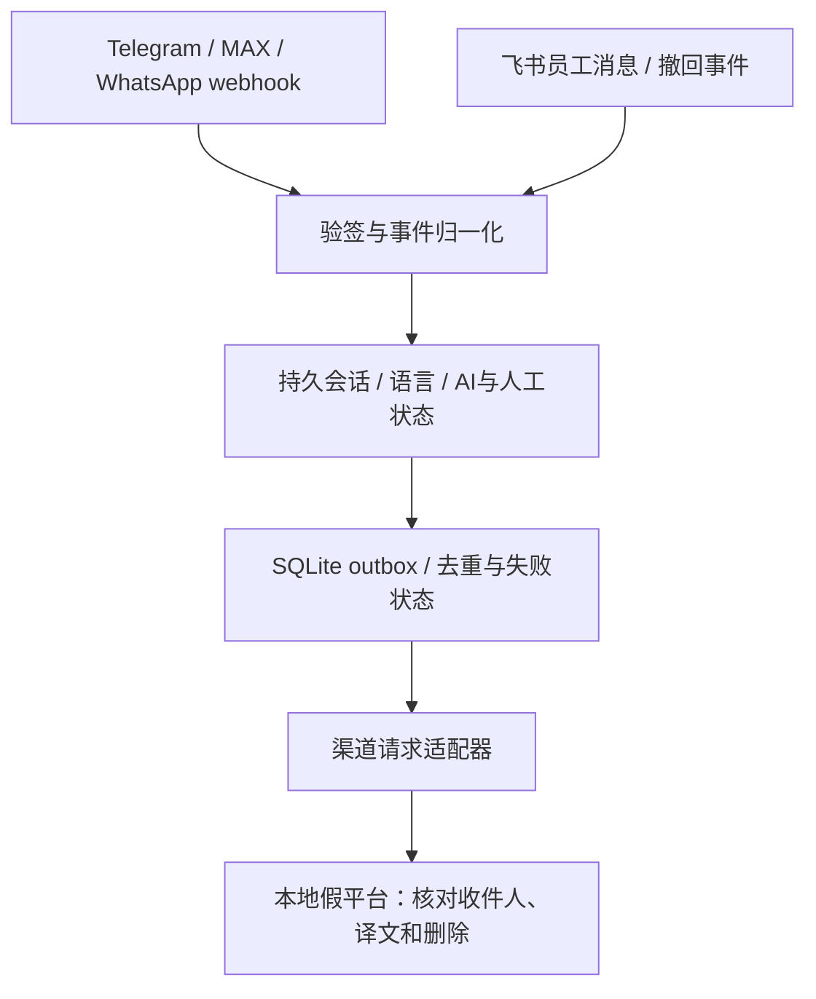

# OmniService

个人账号客服桥接。客户继续添加你的原账号，6–7 人团队在飞书对应客户群里回复。系统识别客户语言、翻译员工普通消息，通过原账号发送；支持 AI、人工接管、撤回和重启恢复。

## 当前交付：P1 可运行的个人账号桥接

**已完成不依赖真实账号的开发和 Linux 验收：187 项测试全部通过。** Telegram 原账号、飞书员工、本地翻译/AI 已连成运行链路；模拟验证使用真实 HTTP 客户端、SQLite、独立假平台及合成模型响应。官方飞书 SDK 1.9.0 另行通过实际事件解析、protobuf ACK、持久提交及启停检查。没有使用你的真实账号或 M6/DGX 模型。

| 部分 | 当前交付 |
|---|---|
| Telegram 原账号 | Secretary Mode 连接、长轮询、白名单、本人接管、代发和精确回执撤回 |
| 飞书员工 | 官方长连接、每客户建群、7 人普通回复、员工权限、原生撤回及服务通知 |
| M6 / DGX | 两个独立本地 HTTP 配置；兼容 Chat Completions、Ollama，翻译另支持 LibreTranslate |
| 知识库 | 中俄英合成物流资料、批准答案与来源记录，未知内容转人工 |
| 恢复与管理 | 持久队列和游标、未知结果核对、失败建群重试、翻译重试、管理 CLI、单实例锁、备份及 systemd 模板 |
| WhatsApp / MAX | 保留 P0 模拟；普通私人账号 live 接入尚未实现，具体平台条件见下文 |

- [开发分支与 PR #4](https://github.com/reknottycat/omni-service/pull/4)：`feature/personal-account-bridge`，基于 PR #2，尚未合并。
- [你需要准备的账号资料和完整启动步骤](docs/setup.md)
- [个人账号能力、官方依据及未验证边界](docs/personal-account.md)
- [P1 验收证据](docs/evidence/personal-acceptance.md)
- [后续真实联调 Issue #3](https://github.com/reknottycat/omni-service/issues/3)

真实运行不需要公网入口：Telegram 采用长轮询，飞书采用出站长连接。密钥只在部署主机保存。员工无需分别登录客户账号。

WhatsApp 官方 Business app 共存不等于普通私人账号 API，本项目尚未启用非官方关联设备。MAX 原账号当前 Open Client API 条件限制服务端桥接，等待平台允许的路线。不要把 P0 Bot 模拟当作两者的私人号接通。

## 保留的 P0：三渠道 Linux 模拟闭环

P0 保留可运行的协议与会话验收台。HTTP webhook、渠道适配、SQLite 队列、会话状态及出站 HTTP 都执行实际代码；平台接收端和 AI/翻译使用确定性模拟服务。P0 与 P1 真实账号验证状态分别记录。

- Telegram / MAX / WhatsApp：一账号多客户、账号和客户隔离、批量回调与去重。
- 飞书：自动/手动建群、加入员工、7 人普通回复默认对客、成员权限及原生撤回事件。
- 语言：根据客户实际消息识别和记忆语言，员工中文自动翻译；当前中、俄、英、西模拟语料用于验证流程。
- AI：已知知识问答自动接待，未知或人工请求建群；员工介入取消未发 AI 并暂停新自动回复，显式恢复后继续；已在途请求按实际回执处理。
- 可靠性：持久 inbox/outbox、重启恢复、429 有限重试、认证失败终止、投递结果未知不盲重发。
- 撤回：发送前取消；Telegram/MAX 发送后删除；WhatsApp 发送后返回不支持；失败或未知单独记录并提示员工。

完整媒体二进制转存、真实模型质量、Chatwoot/NextBridge 联调及真实账号接入已列入[后续范围](docs/acceptance.md#模拟边界与完整产品待办)。媒体解析和请求构造已保留，尚未上传到目的平台的附件标记为 `media_pending`，不会把源平台文件 ID 发到另一平台冒充成功。

## 一条命令验收

环境：Linux、Python 3.12+。运行与测试只用 Python 标准库，无须 pip 安装、数据库服务器、平台 token 或外网访问。

```bash
git clone https://github.com/reknottycat/omni-service.git
cd omni-service
git checkout feature/personal-account-bridge
bash scripts/acceptance.sh
```

结果写入 `artifacts/acceptance.json` 和 `artifacts/acceptance.log`。失败返回非零退出码。报告记录每项测试结果、Linux/Python/SQLite 环境、源文件 SHA256 清单和源码总指纹。合并后可直接使用主分支，是否合并见关联 PR。

查看三个渠道的完整模拟对话：

```bash
python3 scripts/demo.py
python3 scripts/demo_personal.py
```

第一个演示保留三个 P0 渠道；第二个演示验证原账号请求、真实模型 HTTP 接口、7 名员工、重启恢复、撤回、隐私过滤及物流知识库。均只请求 loopback，不发送真实客户消息。

## P0 消息如何流动



服务群普通成员消息默认同步给对应客户，不增加内部/外部两种发送模式。平台服务通知由机器人发给员工，不会回环为新的客户回复。P1 客户在 Telegram 仍看到原个人账号，员工以配置姓名署名。

## P0 模拟 HTTP 接口

`scripts/demo.py` 自动管理本地假平台和服务。手动调试时可使用 `python3 -m omni_service.server --fake-platform-url http://127.0.0.1:<port> --db state.sqlite3 --port 8080`，并设置 `PYTHONPATH=src`。每次 webhook 只做持久接收，调用 `/api/drain` 处理到期队列，便于模拟限流、重启和撤回竞态。

| 接口 | 用途 |
|---|---|
| `GET /health` | 返回明确的 `simulation` 模式 |
| `POST /webhooks/{channel}/{account_id}` | 带对应平台认证的 webhook |
| `GET /webhooks/whatsapp/{account_id}` | WhatsApp challenge 校验 |
| `GET /api/conversations` | 查看隔离会话 |
| `GET /api/conversations/{id}` | 查看成员、消息、译文、投递与撤回状态 |
| `POST /api/conversations/{id}/handoff` | 转人工并建立飞书会话 |
| `POST /api/conversations/{id}/members` | 加入员工，JSON 字段 `staff_id` |
| `POST /api/conversations/{id}/resume` | 恢复 AI |
| `POST /api/conversations/{id}/messages/{mid}/recall` | 请求撤回，JSON 字段 `actor_id` |
| `POST /api/drain` | 执行当前到期的持久队列 |

`/api/*` 需要 `Authorization: Bearer simulation-admin`。默认模拟账号及 webhook secret 在 `server.DEFAULT_ACCOUNTS`；这些是公开测试值。程序限制监听和出站目的地为本机 loopback，拒绝真实平台 URL 和重定向。不要把此模式直接暴露到公网。

## 状态含义

| API / 数据状态 | 含义 |
|---|---|
| `cancelled` | 尚未外发的消息已取消，即验收中的 queued cancellation |
| `sent` | 平台接口确认接收并返回消息 ID；不代表客户已读 |
| `deleted` | 平台明确确认删除 |
| `unsupported` | 当前接口没有发送后撤回能力 |
| `failed` | 明确失败，原发送结果不被篡改 |
| `delivery_unknown` / outbox `unknown` | 请求结果不确定，保留核对依据且不自动重发 |
| `translation_unavailable` | 未取得有效译文，提示员工并保持未发送；P1 支持服务恢复后显式重试 |
| `blocked_window` | WhatsApp 或 Telegram connected-account 普通回复超出相应窗口 |
| `media_pending` | 附件尚待目的平台上传，不能当作已转发 |

## 验收、进度和依据

- [交付 PR #2](https://github.com/reknottycat/omni-service/pull/2)：87 项 Linux 模拟测试通过，未合并；远端 CI 单独阻塞。
- [总控 Issue #1](https://github.com/reknottycat/omni-service/issues/1)
- [验收合同与完整产品待办](docs/acceptance.md)
- [任务进度](docs/progress.md)
- [参考 pstack 的工作流程](docs/workflow.md)
- [追加式决策日志](docs/decisions.tsv)
- [官方渠道契约与来源](docs/channel-contracts.md)
- [Linux 模拟验收证据](docs/evidence/linux-mock-acceptance.md)
- [P1 个人账号开发验收证据](docs/evidence/personal-acceptance.md)
- [P1 资料准备、启动与恢复命令](docs/setup.md)

GitHub Actions 在 Linux 上执行同一验收脚本并保存报告。模拟验收、远端 CI、PR 合并与真实接入状态分别记录；不把本地样本规模外推成生产并发能力。
